 <div align="center">

# <span style="color:#00FF41;">ALAN</span> <span style="color:#E5E7EB;">JOSEPH</span> <span style="color:#FF003C;">ABRAHAM</span>

```text
╔══════════════════════════════════════════════════════╗
║  ROOT@ALAN1492:~# INITIALIZING SECURE ENVIRONMENT    ║
╚══════════════════════════════════════════════════════╝
```

```text
[+] Identity     : Alan Joseph Abraham
[+] Domain       : Cybersecurity & Digital Forensics
[+] Environment  : AI / ML / Python
[+] Mission      : Analyze. Investigate. Secure.
[+] Access       : GRANTED
```


<p>
  
  
  
</p>



```text
[ CYBERSECURITY ]  [ DIGITAL FORENSICS ]  [ AI / ML ]
```

</div>

---

## `01 // whoami`

```bash
root@alan1492:~$ cat identity.txt
```

I'm an M.Tech student specializing in **Cyber Forensics & Information Security**, interested in understanding how systems fail, how attacks unfold, and how digital evidence can reveal what happened.

My work combines cybersecurity exploration, digital forensics, Python development, and AI/ML experimentation to build practical tools and investigate technical problems.

```text
┌──[ OPERATOR PROFILE ]
│
├── Education  : M.Tech — Cyber Forensics & Information Security
├── Security   : Cybersecurity & Digital Forensics
├── Research   : AI/ML, Autoencoders, Sequence Modeling
├── Language   : Python
├── Approach   : Analyze → Investigate → Build → Improve
└── Status     : CONTINUOUSLY LEARNING
```

## `02 // security_operations`

```bash
root@alan1492:~$ ./security_focus.sh
```

```text
[01] DIGITAL FORENSICS
     ├── Digital evidence examination
     ├── Artifact analysis
     └── Incident investigation

[02] CYBERSECURITY
     ├── Network security fundamentals
     ├── Threat detection and analysis
     └── Security experimentation

[03] AI FOR SECURITY
     ├── Anomaly detection
     ├── Neural networks and autoencoders
     └── Machine learning experimentation

[04] TOOL DEVELOPMENT
     ├── Python automation
     ├── Data analysis
     └── Practical security utilities
```

*Areas of exploration — not a claim of professional expertise in every listed domain.*

## `03 // tech_stack`

<p>
  
  
  
  
  
  
  
  
</p>

```text
[LANGUAGES]       Python | Bash
[AI / ML]         TensorFlow | Keras | Neural Networks
[DATA]            NumPy | Pandas | Jupyter
[APPLICATIONS]    Streamlit
```

## `04 // deployed_projects`

```bash
root@alan1492:~$ ls -la ~/repositories/
```

<table>
  <tr>
    <td>
      <strong><a href="https://github.com/Alan1492/Autoencoders-in-CNN-and-LSTM">01. Autoencoders-in-CNN-and-LSTM</a></strong><br /><br />
      <code>[ AI / DEEP LEARNING ]</code><br />
      CNN and LSTM autoencoder experiments focused on representation learning.
    </td>
    <td>
      <strong><a href="https://github.com/Alan1492/Sequence-Autoencoder-Using-RNN-LSTM-RNN-LSTM-based-Autoencoder-">02. Sequence Autoencoder</a></strong><br /><br />
      <code>[ SEQUENCE MODELING ]</code><br />
      Exploring sequence-based learning with recurrent neural networks.
    </td>
  </tr>
  <tr>
    <td>
      <strong><a href="https://github.com/Alan1492/Streamlit2">03. Streamlit2</a></strong><br /><br />
      <code>[ PYTHON / DATA APPS ]</code><br />
      Interactive applications and Python experimentation.
    </td>
    <td>
      <strong>04. Next Investigation</strong><br /><br />
      <code>[ CLASSIFIED: IN PROGRESS ]</code><br />
      More experiments, security tools, and research projects loading...
    </td>
  </tr>
</table>

## `05 // active_learning`

```text
┌─[ LEARNING PIPELINE ]
│
├── [x] Neural networks
├── [x] Autoencoders
├── [x] Sequence modeling
├── [x] Interactive AI tools
├── [x] Cybersecurity fundamentals
├── [x] Digital forensics
├── [ ] Network traffic analysis
├── [ ] Threat detection experiments
├── [ ] AI-assisted security research
└── [ ] More open-source security tools
```

## `06 // github_intelligence`

<div align="center">
  
  <br />
  
</div>

## `07 // establish_connection`

```bash
root@alan1492:~$ ./connect.sh --protocol=github
```

<p>
  <a href="https://github.com/Alan1492">
    
  </a>
  <a href="#">
    
  </a>
</p>

<div align="center">

```text
╔══════════════════════════════════════════════════════╗
║  SESSION STATUS : ACTIVE                             ║
║  SECURITY MODE  : ENABLED                            ║
║  OPERATOR       : ALAN1492                           ║
║  NEXT OBJECTIVE : KEEP BUILDING                      ║
╚══════════════════════════════════════════════════════╝
```

<code>Think like an investigator. Build like an engineer. Secure by design.</code>

</div>
